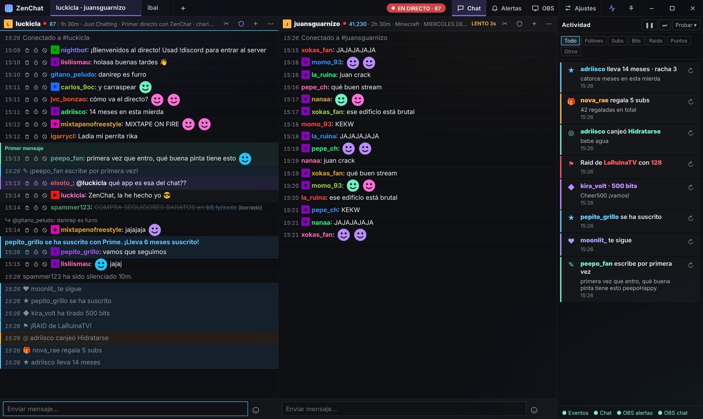
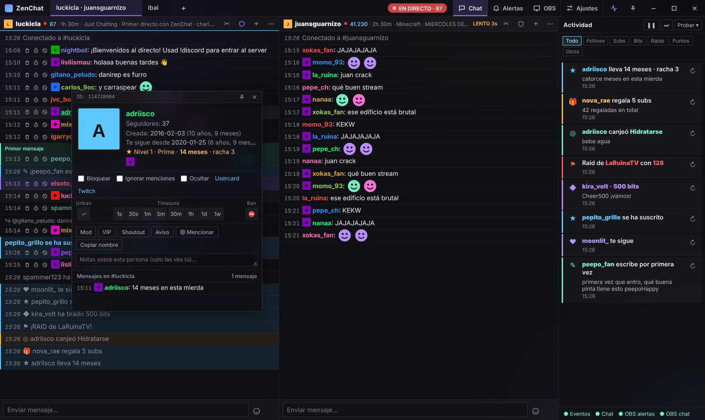
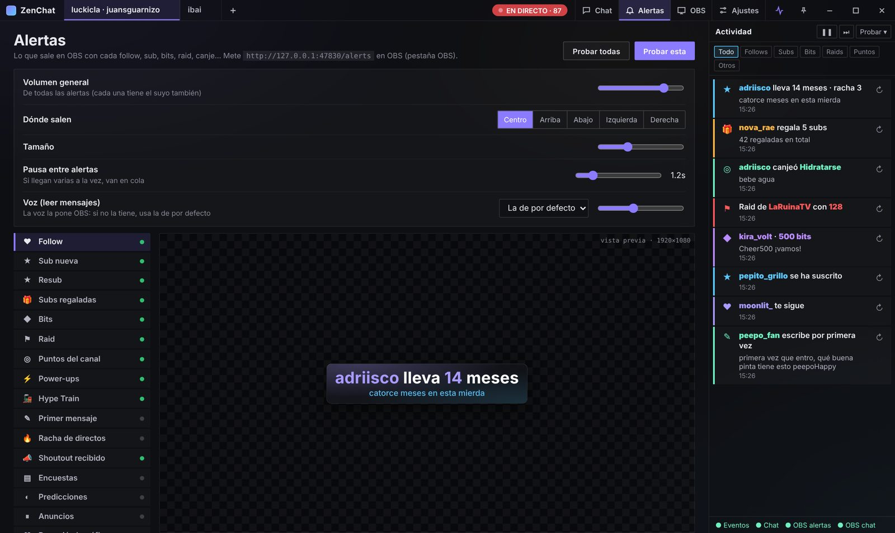
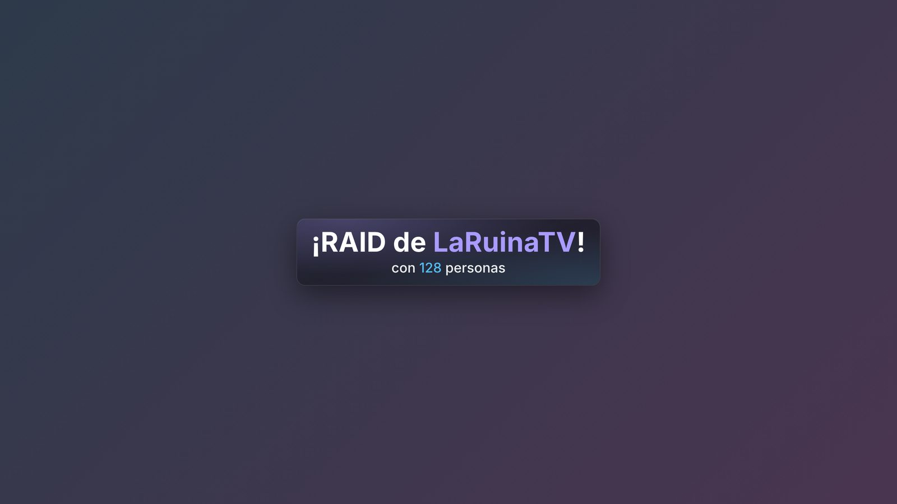
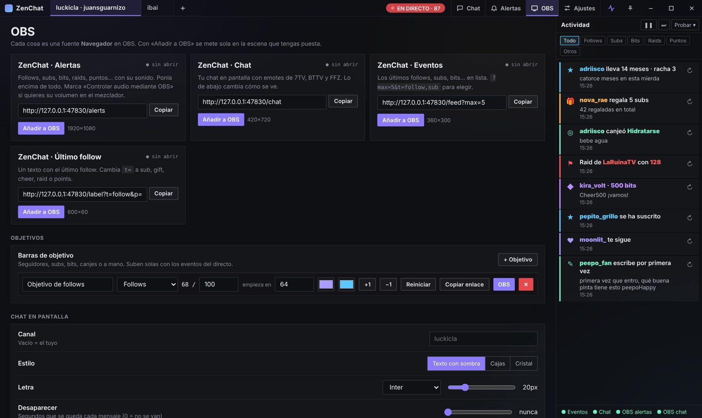
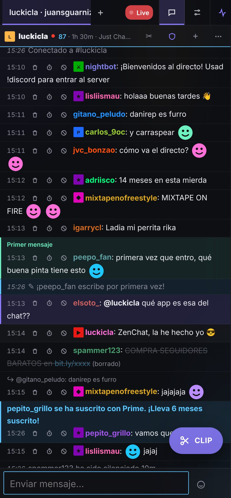
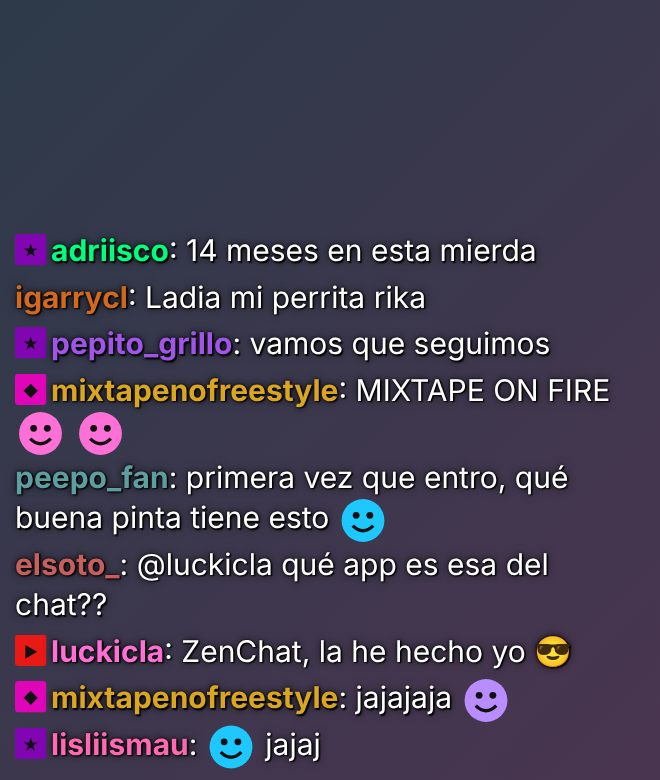

# ZenChat

ZenChat es mi app para hacer directos en Twitch. Es el chat al estilo Chatterino (cuadradito, compacto, con su tarjeta de usuario y los botones de moderar a mano) con paneles de cristal translúcidos, y además hace las alertas de OBS con sus sonidos: follows, subs, bits, raids, puntos del canal, hype train y lo demás. También hay APK para leer el chat en el móvil y sacar clips en vertical para TikTok con un botón.

  
  

  
  

  
  

Los nombres y mensajes de las capturas son de prueba.

## Descargar

En [Releases](https://github.com/luckicla/ZenChat/releases):

- **Windows, instalador**: `ZenChat-Instalador.exe`. Se instala como una app más y se actualiza sola.
- **Windows, portable**: `ZenChat-Portable.exe`. Sin instalar: los ajustes van en la carpeta `ZenChat-datos`, al lado del .exe.
- **Android**: `ZenChat.apk` (Android 10 o más nuevo). Se instala a mano y avisa cuando hay una nueva.

Cada push a `main` compila todo solo en GitHub Actions (`.github/workflows/build.yml`).

## Primera vez

1. **Client ID de Twitch** (una vez, 2 minutos). Entra en [dev.twitch.tv/console/apps](https://dev.twitch.tv/console/apps/create) → «Registrar tu aplicación»: el nombre que quieras, URL de redirección `http://localhost`, categoría «Chat Bot» y tipo de cliente **Público**. Copia el ID de cliente y pégalo en ZenChat → Ajustes → Cuenta.
   Si lo pones en `client.json` (o como variable `TWITCH_CLIENT_ID` del repo, en *Settings → Secrets and variables → Actions → Variables*), va metido en el instalador y en la APK y no hay que pegarlo.
2. **Entrar con Twitch**: ZenChat te enseña un código, se abre twitch.tv/activate y le das a Autorizar. No pide tu contraseña.
3. **OBS**: en la pestaña OBS de ZenChat, «Añadir a OBS» mete cada overlay en la escena que tengas puesta. Antes activa en OBS *Herramientas → Ajustes del servidor WebSocket* y pega la contraseña en ZenChat. También se puede a mano: fuente *Navegador* con la dirección de abajo.

## Qué hace

**El chat (como Chatterino)**
- Pestañas arriba y varios canales lado a lado en cada una. Ctrl+T abre una pestaña, Ctrl+W la cierra, Ctrl+1…9 salta.
- Líneas compactas con hora, insignias, colores de nombre legibles y los emotes de Twitch, **7TV, BTTV y FFZ** (globales y del canal).
- Menciones resaltadas con sonido y aviso de Windows, palabras que te avisan, primeros mensajes marcados, subs, canjes, anuncios y bits en su color.
- Mensajes borrados tachados, timeouts y bans en el chat, respuestas (clic derecho → Responder) y los mensajes de antes al abrir un canal.
- Se pausa al pasar el ratón o al subir, como Chatterino.
- Autocompletar con Tab, `@nombre` y `:emote`, flechas para repetir lo que escribiste y selector de emotes.
- Comandos: `/ban`, `/timeout`, `/unban`, `/warn`, `/clear`, `/slow`, `/followers`, `/subscribers`, `/emoteonly`, `/mod`, `/vip`, `/so`, `/announce`, `/raid`, `/commercial`, `/title`, `/game`, `/marker`, `/poll`, `/clip`… (`/help` los lista).

**La tarjeta de usuario**
- Foto, seguidores, cuándo creó la cuenta, desde cuándo te sigue, su sub (nivel, Prime o regalada, meses y racha), insignias y todo lo que ha escrito en el canal.
- Bloquear, ignorar sus menciones, ocultarle, abrir la usercard de Twitch.
- Unban, timeouts de 1s, 30s, 1m, 5m, 30m, 1h, 1d y 1w, ban, mod, VIP, shoutout, aviso y notas tuyas sobre esa persona.
- Se fija con la chincheta y se arrastra. Puede haber varias abiertas.

**Alertas para OBS** (`http://127.0.0.1:47830/alerts`)
- Follow, sub, resub, subs regaladas, bits, raid, puntos del canal, power-ups, hype train, primer mensaje, racha de directos, shoutout recibido, encuestas, predicciones, anuncios, donación benéfica y objetivo cumplido.
- Cada una con su texto (`{user}`, `{amount}`, `{months}`, `{message}`…), imagen, GIF o vídeo WEBM, sonido (20 de serie hechos con el sintetizador, o el tuyo), volumen, duración, animación, letra y colores.
- Variaciones por cantidad (p. ej. desde 1000 bits otro sonido) y una alerta distinta para cada recompensa de puntos.
- Leer el mensaje en voz alta, cola cuando llegan varias, pausar, saltar y repetir desde Actividad.

**Más cosas para OBS**
- `/chat`: el chat en pantalla con emotes (sombra, cajas o cristal; que desaparezcan o no; sin comandos ni bots).
- `/goal?id=…`: barras de objetivo de follows, subs, bits, canjes o a mano.
- `/feed`: los últimos eventos en lista. `/label?t=follow`: el último follow, sub, bits…

**Actividad**: a la derecha, todo lo que pasa en el directo, con filtros y ↻ para repetir la alerta.

**Clips**: ✂ en cada canal (o Ctrl+Mayús+C) hace un clip. En el PC te da el enlace y el editor de Twitch. En el móvil se baja, se recorta a **vertical 1080×1920** (centro, izquierda o derecha) y se guarda en la galería, con botón para compartirlo directo en TikTok.

**A tu gusto**: temas de color, paneles de cristal con el desenfoque que quieras, imagen de fondo, transparencia acrílica de Windows 11, siempre encima, opacidad de la ventana, tamaño de letra y emotes, esquinas…

## Cómo está hecho

- `main.js`, `preload.js`, `src/`: la app de escritorio (Electron). `src/server.js` sirve los overlays en el puerto 47830 y les manda lo que pasa al momento.
- `app/`: la interfaz. La misma en el PC y en la APK (en el móvil, `app/js/platform.js` hace de puente con Android).
- `overlay/`: las páginas que se meten en OBS.
- `android/`: la APK (un WebView con la interfaz de `app/` y Media3 para recortar los clips).
- Twitch: chat por IRC, eventos por EventSub (WebSocket) y la API Helix. Sub y followage de [ivr.fi](https://api.ivr.fi), historial de [recent-messages](https://recent-messages.robotty.de), emotes de 7TV, BTTV y FFZ.

Probar sin compilar: `npm install && npm start`. Los overlays solos: `node tools/serve.js`.

## Creador

**luckicla**.
